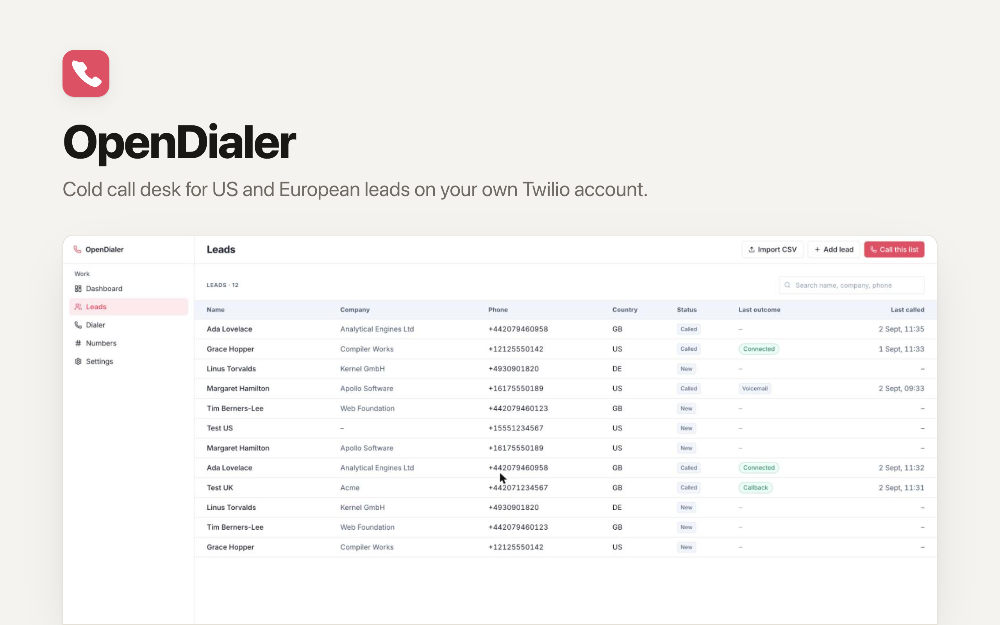

<p align="center">
  <picture>
    <source media="(prefers-color-scheme: dark)" srcset="./readme-banner-dark.png">
    
  </picture>
</p>

# OpenDialer: The Open-Source Aircall Alternative

[](https://app.clawnify.com/deploy?repo=clawnify/OpenDialer)

A phone system for sales and support teams that runs in the browser. Customers call your number, hear your menu, and every available teammate's browser rings at once; the first to answer takes the call. Missed calls and voicemails land in a shared inbox until someone calls back. Reps also work lead lists with click-to-call and a local caller ID. Runs on your own Twilio account, so you pay carrier rates and nothing per seat. An open-source app template provided by [Clawnify.com](https://clawnify.com).

Built with **React + Tailwind** on a **Hono API** and a **SQLite** database. Path-based routing, UUID keys, a dark mode that follows the OS, and a full OpenAPI surface so an agent can prepare lists, read the call log and work the inbox.

## What it does

**Taking calls**

- **Numbers that ring your team**: connect any number on the Twilio account. The app sets its voice URL for you and puts the old routing back when you disconnect. Only workspace admins can change numbers and teams.
- **Press-a-digit menu**: "For sales, press 1. For support, press 2." Each option rings a team. No key pressed goes to voicemail.
- **Teams (ring groups)**: every available member's browser rings at once and the first answer wins. Ring time per team.
- **Business hours** per number, in its own time zone. Outside them callers hear your closed message and can leave a voicemail.
- **Availability**: each rep switches between Available and Away. Calls ring only reps who are available, have the app open, and are not already on a call.
- **Warm and blind transfer** to a teammate or a whole team. Warm: you introduce the caller, then hang up. Blind: you drop off the moment they answer. If nobody takes a transfer, the caller stays with you.
- **Voicemail** when nobody answers, with your own greeting.
- **Shared inbox** for missed calls and voicemails: listen to the message, assign it, call back, mark it handled.
- **Caller context** when it rings: the lead's name if the number is known, which number they dialled and which team is ringing.

**Making calls**

- **Leads**: add, edit, delete, search. CSV import with phone normalisation to E.164; bad rows are counted and reported, not silently dropped.
- **Click-to-call from the browser** with the Twilio Voice SDK. Microphone and speaker in the page, nothing to install.
- **Local presence**: pick a caller ID, or let the app choose a number in the lead's country (matching US area code first). It never shows a foreign number when a local one exists.
- **Outcomes** after every call: Connected, Voicemail, No answer, Busy, Wrong number, Not interested, Callback, Do not call.
- **Campaigns**: pick a list and work it one lead at a time. You click **Next**; nothing auto-dials.
- **Fallback mode** when browser calling is not configured: Twilio calls your phone first, then bridges you to the lead.

**For both**

- **Team call log**: every inbound and outbound call, who handled it, duration, outcome, tags, notes and recording.
- **Notes and tags** on any call, during or after it. Filter the log by tag.
- **Recording on by default** (per number for inbound, per rep for outbound). Audio stays at Twilio; the app keeps the link and streams it through its own player.
- **Save an unknown caller as a lead**: their earlier calls are filed under the new lead.

Not in this version: SMS, live listen/whisper, call queues with position announcements, CRM sync, transcripts and AI summaries, predictive or parallel dialing, and auto-dialing without a human click. The conference-based call model leaves room for listen and whisper.

## Markets

US and Canada, the UK and Ireland, and 14 European countries: DE, FR, ES, IT, NL, BE, AT, CH, SE, NO, DK, FI, PL, PT. Numbers from other regions are rejected before dialing.

## Setup

The app needs an upgraded (paid) Twilio account with at least one voice-capable number: Twilio's trial program strips the `<Dial>` that bridges a call to a phone. [SETUP.md](SETUP.md) walks through the console: number, API key, TwiML App, geographic permissions, and the environment variables. Taking calls needs the API key but not the TwiML App; the number's voice URL is set from the Numbers page, not in the console.

```
TWILIO_ACCOUNT_SID      required
TWILIO_AUTH_TOKEN       required
TWILIO_FROM_NUMBER      optional pin for the default caller ID; else the first synced number
TWILIO_TWIML_APP_SID    outbound calls from the browser
TWILIO_API_KEY_SID      browser calling, inbound and outbound
TWILIO_API_KEY_SECRET   browser calling, inbound and outbound
PUBLIC_APP_URL          optional; the request origin is used by default
```

Missing variables show up as a banner and on **/settings**, never as a blank page. Secrets are never sent to the browser.

### Where each value comes from

Twilio is the only provider today. Every value in `.dev.vars.example` maps to one place in the [Twilio Console](https://console.twilio.com):

| Variable | Twilio console | Notes |
|---|---|---|
| `TWILIO_ACCOUNT_SID` | Console home → Account Info → **Account SID** | Starts with `AC` |
| `TWILIO_AUTH_TOKEN` | Console home → Account Info → **Auth Token** (click Show) | Also signs the webhooks the app verifies |
| `TWILIO_FROM_NUMBER` | Phone Numbers → Manage → **Active numbers** | Optional pin, E.164. Without it the first synced number is the default |
| `TWILIO_API_KEY_SID` | Account → Keys & Credentials → API keys & tokens → **Create API key** (type Standard) | Starts with `SK`. Not the Account SID |
| `TWILIO_API_KEY_SECRET` | Same dialog, shown once | Copy it before closing |
| `TWILIO_TWIML_APP_SID` | Voice → Manage → **TwiML apps** → your app | Starts with `AP`. Its voice URL must be `https://<your app host>/api/twilio/voice` |
| `TWILIO_REGION` | Console region selector (top right on credential pages) | `us1` (default) or `ie1`. See Ireland region below |
| `PUBLIC_APP_URL` | not from Twilio | Only for a tunnel during local development |

The two pairs are easy to swap and the symptom is the same either way, "The Twilio token was rejected": the **Account SID + Auth Token** identify the account and sign webhooks; the **API key SID + secret** sign the browser's Voice token. On Clawnify the first pair goes under Settings → API Keys → Twilio as `ACCOUNT_SID:AUTH_TOKEN`, the other four under Settings → Environment Variables. Step-by-step clicks, including the account upgrade and business-profile approval Twilio requires before Voice works: [SETUP.md](SETUP.md).

### Ireland region (EU data residency)

Set `TWILIO_REGION=ie1` to keep call processing, recordings and the browser media path inside Twilio's Ireland region. A region is a whole credential set, not a switch:

- The Account SID is the same, but the **Auth Token, API key and TwiML App are region-specific**. Create all three inside the Ireland region of the console: the pages live under `https://console.twilio.com/ie1/…` (API keys: `/ie1/account/keys-credentials/api-keys`, TwiML Apps: `/ie1/develop/voice/manage/twiml-apps`), and the page badge says "Ireland (IE1) Region". Put the IE1 values in the variables above.
- The app then talks to `api.dublin.ie1.twilio.com`, signs Voice tokens for IE1, and connects the browser through the Dublin edge.
- Each phone number's inbound processing region must be Ireland as well (Phone Numbers → the number → Voice region, or the Inbound Processing Region API); changes take up to five minutes.
- One deployment runs in one region. To serve both markets with residency guarantees, deploy the app twice.

## Pages

| Path | What |
|---|---|
| `/` | Leads to call today, callbacks due, last 20 calls, **Start calling** |
| `/inbox` | Missed calls and voicemails: play, assign, call back, mark handled |
| `/calls` | The team call log, inbound and outbound, filterable by direction and tag |
| `/leads` | Table with search, add lead, CSV import, **Call this list** |
| `/leads/:id` | Lead detail, call history, recordings |
| `/dialer` | The working screen: lead card, caller ID picker, Call / Hang up, timer, outcomes, next lead |
| `/teams` | Teams (ring groups), their members and ring time; who is available right now |
| `/numbers` | Numbers on the Twilio account: sync, and per number its menu, team, business hours, voicemail greeting and recording |
| `/settings` | Provider status, default number, webhook URLs, your callback number |

## CSV format

```
first_name,last_name,company,phone,country,notes
Ada,Lovelace,Analytical Engines Ltd,+44 20 7946 0958,GB,Asked for a demo
Grace,Hopper,Compiler Works,(212) 555-0142,US,Prefers mornings
```

`phone` may be national format when `country` is filled. See [leads.sample.csv](leads.sample.csv).

## How an inbound call works

1. A customer dials a connected number. Twilio asks `POST /api/twilio/inbound`, which creates the call record (linked to the lead if the number is known) and checks the number's business hours.
2. Closed: the closed message plays and the caller can leave a voicemail. Open: the greeting and menu play (`POST /api/twilio/menu` receives the digit).
3. The caller waits in a conference with hold music while the app rings the team: one Twilio call per available rep, to that rep's browser.
4. The first rep to answer claims the call; the other browsers stop ringing. The rep joins the conference and the call starts.
5. A transfer rings the new teammate into the same conference. Warm: the first rep hangs up when ready. Blind: the first rep is dropped as soon as the new one answers.
6. When the last rep hangs up the caller is hung up too. When the last phone rings out with nobody on the line, the caller goes to voicemail, and the call appears in the inbox.

Why a conference and not a direct bridge: it is what lets a second person join a live call, which is what transfers need, and later listen and whisper.

## How an outbound call works

1. **Call** → `POST /api/calls` validates the lead, picks the caller ID, creates a call record, and returns a short-lived Voice token.
2. The browser connects through the Twilio Voice SDK; Twilio asks `POST /api/twilio/voice` for TwiML, which bridges the browser to the lead's number with recording on.
3. Twilio reports each status change to `POST /api/twilio/status` and the finished recording to `POST /api/twilio/recording`. Every webhook is signature-checked against the auth token.
4. The page polls the call once a second until it ends; you save an outcome, then click **Next**.

The telephony layer lives in one file (`src/server/twilio.ts`) behind a small surface: list and connect numbers, create, redirect and end calls, fetch recording, access token, TwiML. Routing decisions (who rings, who gets the call, voicemail) live in `src/server/inbound.ts`. Another carrier can be added behind the same shape without touching the UI.

## Compliance

You are placing live outbound calls and recording calls. You are responsible for complying with US TCPA, DNC rules, and European GDPR/ePrivacy and country-specific calling rules. Recording laws vary: where callers must be told, say so in the number's greeting, or switch recording off for that number. The app shows a reminder on the dialer; it does not make you compliant.

## Local development

```bash
pnpm install
cp .dev.vars.example .dev.vars   # fill in Twilio values
pnpm dev                          # UI on :5173, API on :8789
pnpm seed                         # optional demo leads
pnpm test
```

Twilio must reach your webhooks. For local calls, expose port 8789 with a tunnel and set `PUBLIC_APP_URL` to the tunnel URL.

## API

Every endpoint is described at `/llms.txt` and `/api/openapi.json`. Lists are paginated.

| Method | Path | |
|---|---|---|
| GET | `/api/health` | Liveness and provider status |
| GET, POST | `/api/leads` | List (search, status, country) and create |
| GET, PATCH, DELETE | `/api/leads/:id` | One lead with history |
| POST | `/api/leads/import` | CSV import, returns imported / rejected / duplicates |
| GET | `/api/numbers` · POST `/api/numbers/sync` | Numbers |
| PATCH | `/api/numbers/:id` | Inbound routing: label, team or menu, greeting, hours, voicemail, recording |
| POST | `/api/numbers/:id/connect` · `/disconnect` | Send the number's calls here; restore its previous voice URL |
| GET, POST, PATCH, DELETE | `/api/teams` · `/api/teams/:id` | Teams (ring groups) |
| GET | `/api/reps` · POST `/api/presence` | Who is available; this rep's heartbeat and availability |
| GET | `/api/inbox` | Missed calls and voicemails (open, handled, all) |
| PATCH | `/api/calls/:id` | Notes, tags, assignment, handled |
| GET | `/api/calls/ringing` | The inbound call ringing this rep's browser |
| POST | `/api/calls/:id/transfer` | Warm or blind transfer to a teammate or team |
| POST | `/api/token` | Voice SDK token |
| GET, POST | `/api/calls` | Team call log (direction, status, rep, tag filters); start a call |
| GET | `/api/calls/:id` | Poll a live call |
| POST | `/api/calls/:id/hangup` · `/api/calls/:id/outcome` | End; record outcome |
| GET | `/api/calls/:id/recording` | Streams the recording through the server's auth |
| GET, POST | `/api/campaigns` · `/api/campaigns/:id/next` · `.../leads/:leadId/complete` | Power-dialer queue |
| POST | `/api/twilio/*` | Twilio webhooks (public, signature-checked): outbound `voice` · `status` · `recording`; inbound `inbound` · `inbound-status` · `menu` · `agent` · `leg` · `voicemail` |

## License

MIT
